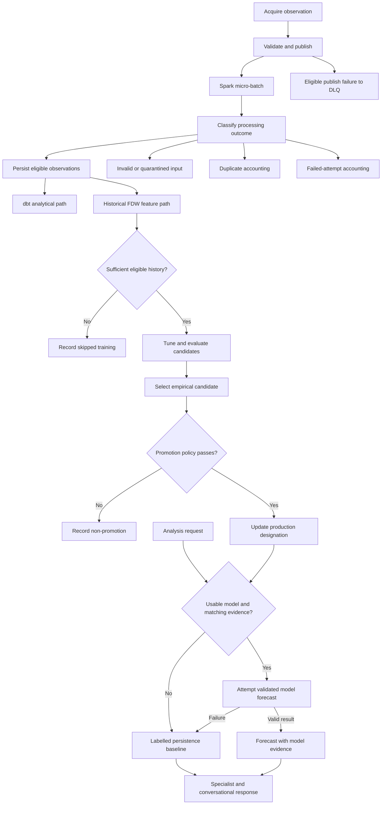

# End-to-end flow

This diagram shows the intended composition of implemented stages, including explicit alternative outcomes. It is not evidence of one successful autonomous execution.

Training and analysis requests have separate triggers. The graph does not imply that each newly acquired event initiates training or that each training run results in model promotion.

See [dataflow](../architecture/dataflow.md) and [prediction](../docs/modules/prediction.md).
