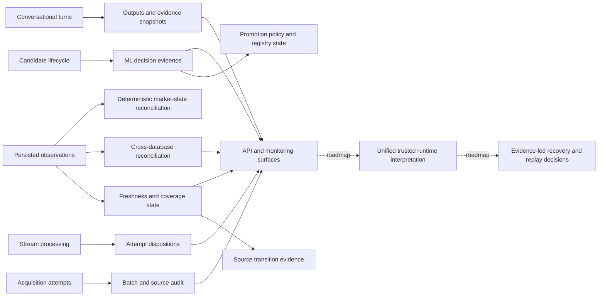

# Governance control plane

The diagram groups implemented evidence surfaces. The unified runtime interpretation is a target beyond the individual records currently available.

Current market trust, source freshness, processing success, model eligibility, and conversational grounding are different questions. A single green task status cannot replace their evidence.

See [governance model](../docs/governance/governance-model.md).
