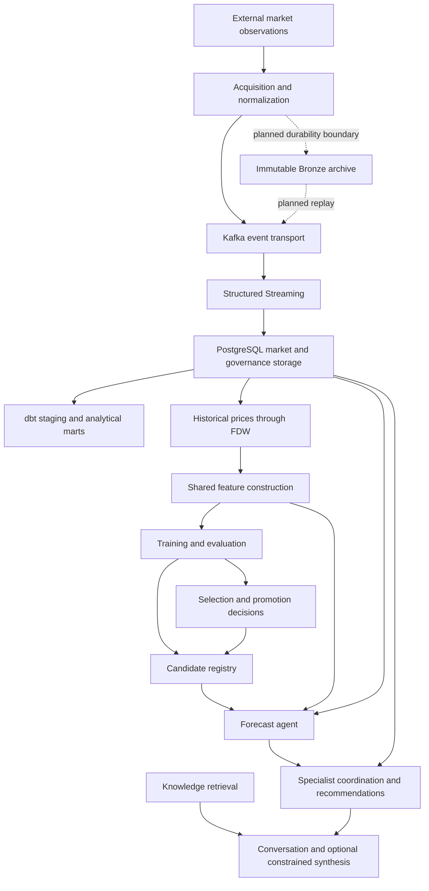

# System architecture

Solid edges show implemented data or invocation relationships. The dashed Bronze branch is a roadmap target. None of the edges implies that a complete production run has been demonstrated.

## Reading the boundaries

- dbt analytics and FDW-based ML features are separate branches.
- A registry-to-forecast edge means an artifact lookup and conditional inference path, not proven successful learned-model serving.
- Agent recommendations do not control acquisition or model promotion in this diagram.
- Kafka retention and checkpoints do not replace the planned durable raw archive.

See [system overview](../architecture/system-overview.md).
